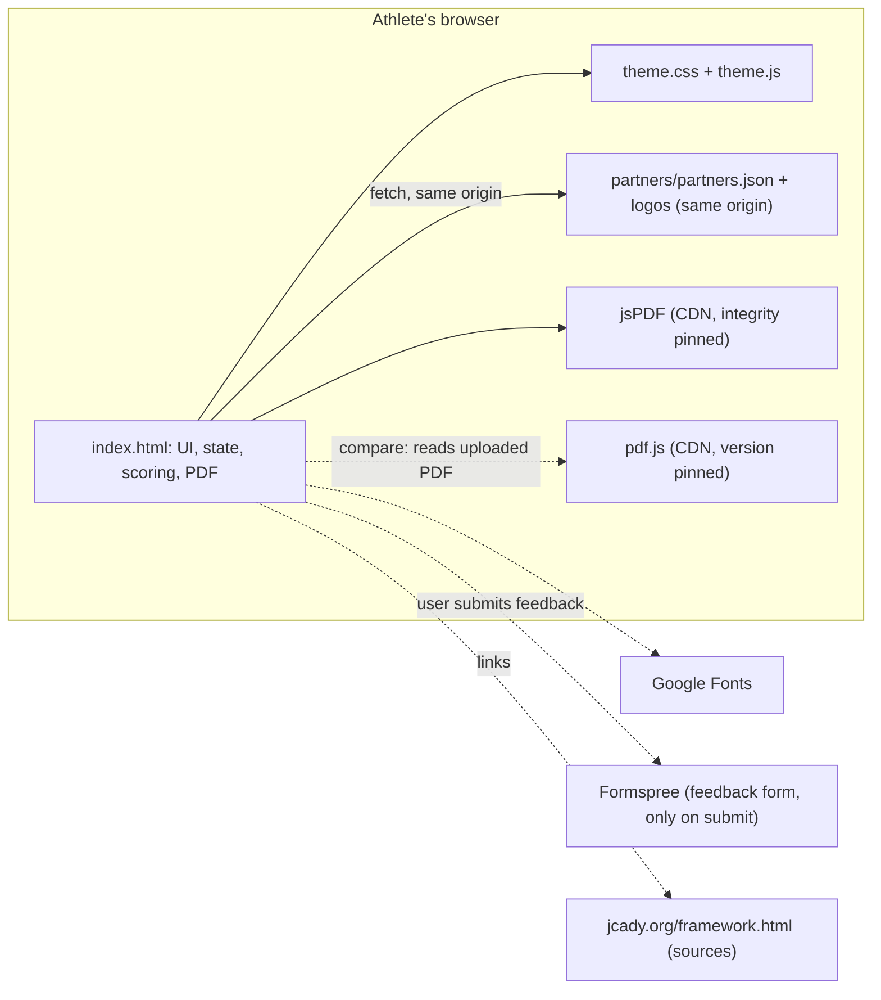
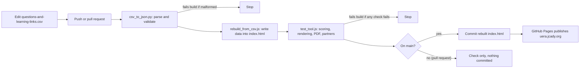
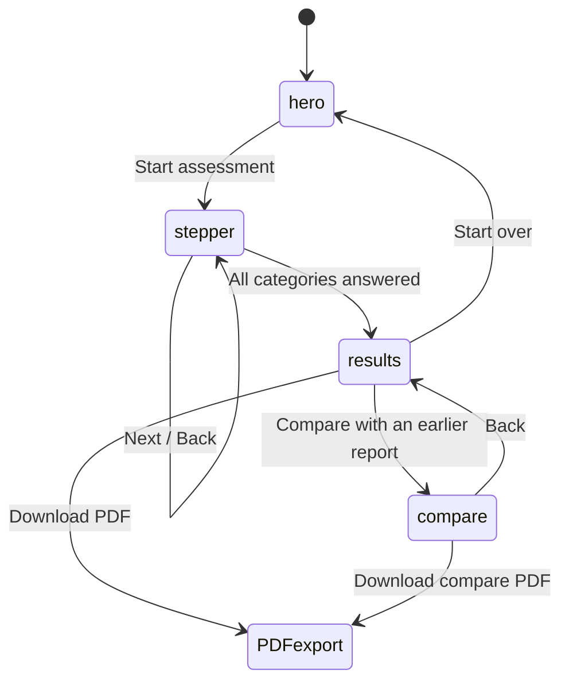
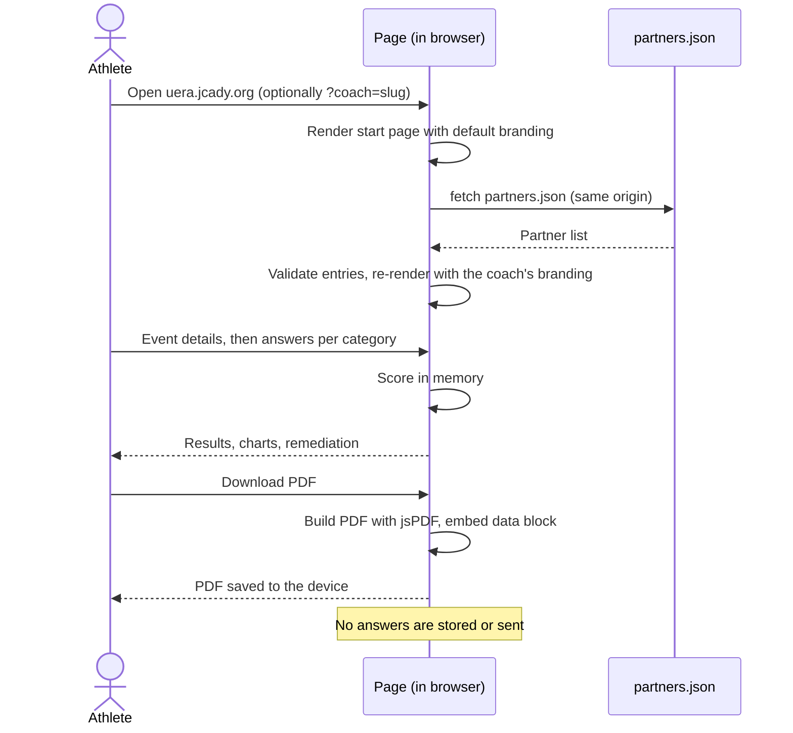
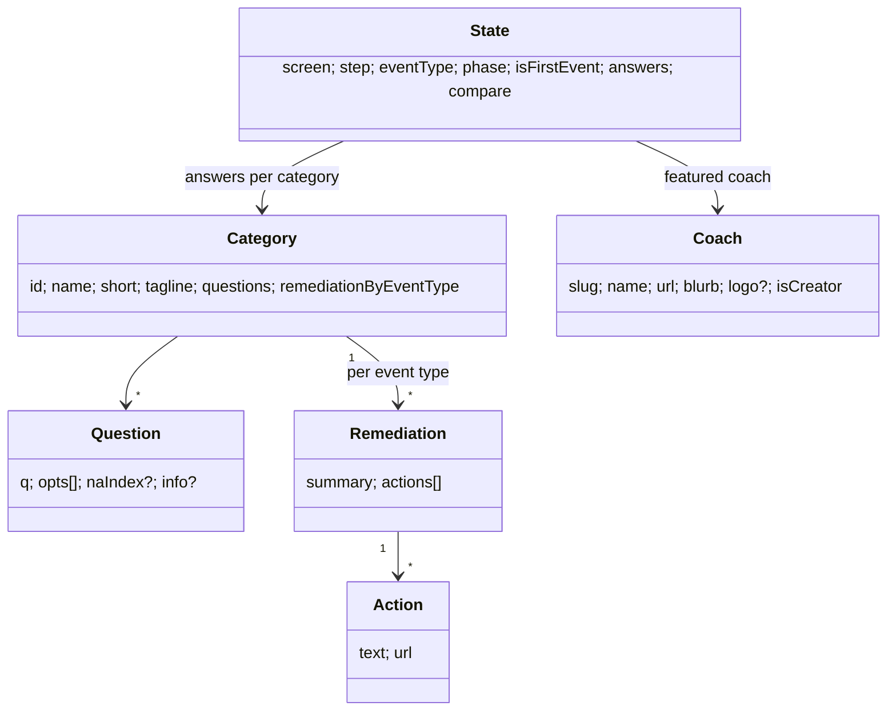
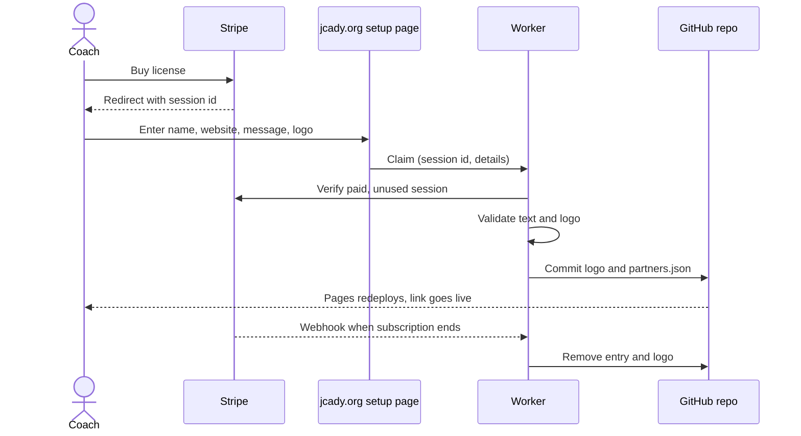

# Architecture

How UERA is put together, as of the current `main` branch. Diagrams are Mermaid and render on GitHub. Sections marked **Planned** describe work that is not live.

## Goals
1. **Private.** Nothing the athlete enters is stored or sent. Everything runs in the browser.
2. **Source-grounded.** Every question and learning link comes from one reviewed file, the CSV.
3. **Safe to change.** A bad edit to the questions must fail the build, not reach the live site.
4. **Free to host, easy to maintain.** Static files on GitHub Pages, no server, no database.
5. **Co-brandable.** A licensed coach's name and logo can appear without changing scoring.

## How it's put together
- **One page.** `index.html` holds the markup, styles, application code and the question data. Outside code and assets come from three places: jsPDF (CDN, version pinned with an integrity hash), pdf.js (CDN, version pinned, loaded as a module so it has no integrity hash) and Google Fonts. Shared styling comes from `theme.css` and `theme.js`.
- **Questions are data.** `CATEGORIES` in `index.html` holds ten categories, each with questions, options, remediation steps and learning links. It is generated from `questions-and-learning-links.csv`. Do not edit the generated block by hand.
- **State is in memory.** A single `state` object tracks screen, step, event details, answers and comparison data. Answers are never written to `localStorage` or cookies. The only stored value is the light/dark choice.
- **Scoring.** Each category score is the average of its answered questions, each scaled 0 to 1 by the chosen option's position, times 100. "N/A" answers count as 0 risk and informational-only questions are excluded. The overall score is the mean of the category scores. Tiers: below 34 Low, below 67 Moderate, otherwise High.
- **Theme.** `data-theme` on `<html>` switches CSS variables between light and dark. The choice is saved in `localStorage` (`uera-theme`) on the device and is the only thing the page ever stores. (The earlier statement that nothing is written to `localStorage` applies to answers, not the theme choice.)
- **PDF.** Generated in the browser with jsPDF. A hidden data block (`UERA_DATA_V1`) is embedded on the last page so a later upload can read scores back reliably instead of parsing the rendered text.

## Components

## Build and publish pipeline

The workflow runs only when the CSV changes. Changes to `index.html` made directly are published as they are, without the rebuild step, so run `test_tool.js` before pushing them.

## Screen states

## Sequence: taking the assessment

## Data model (generated data in index.html)

## Coach partner branding

- **Registry:** `COACH_REGISTRY` in `index.html` holds the built-in coaches. `partners/partners.json` adds more at load time. Built-in entries win over file entries with the same slug.
- **Choosing the coach:** `?coach=slug` first, then a match between the referring site and a coach's website, then the default coach.
- **Safety rules:** slugs match `^[a-z][a-z0-9-]{1,30}$`, websites must be `https`, logo paths must be inside `partners/` and be PNG, SVG, WebP or JPEG, names are capped at 80 characters and messages at 300. A bad entry is skipped, not partially shown. Logos are never loaded from a URL passed in the link.
- **Shown in three places:** start page bar, results coach card, PDF header band. Scoring is unaffected.
- **Adding or removing a partner today:** edit `partners/partners.json` and add the logo, following [partners/README.md](../partners/README.md).

## Planned: self-service partner setup (not live)

A separate Cloudflare Worker that lets a coach set up their own branded link right after buying a license. It would verify the Stripe purchase, validate the text and logo, and publish to `partners/partners.json` through the GitHub API, then remove the entry if the subscription ends. It is built and unit tested with mocked services, but it is **not deployed or tested against live Stripe, GitHub or email**. It would add a second system (the Worker, a KV store and webhooks), which is the only part of UERA that would run on a server.

## Security notes
- Static site, no server, no stored data. Visitors cannot change content.
- Third-party scripts are jsPDF (version pinned, integrity hash) and pdf.js (version pinned, no integrity hash because it loads as a module). Both come from cdnjs. See [SECURITY.md](../SECURITY.md) for reporting.
- User-controlled input that reaches the page (the `coach` query value and the partner list) is validated before use. Uploaded report data is read from a PDF the athlete chooses; its validation has not been separately reviewed. `test_tool.js` covers the partner cases, including a rejected `__proto__` key.
- The feedback form posts to Formspree only when the visitor submits it.

## Limits worth knowing
- The generated question block in `index.html` is large, so diffs on `index.html` are hard to review. Review changes in the CSV.
- Direct edits to `index.html` bypass the CSV rebuild, so the two can drift unless the workflow is rerun.
- Scoring treats all questions equally within a category. Categories are weighted equally in the overall score. That is a design choice, not a research finding.
